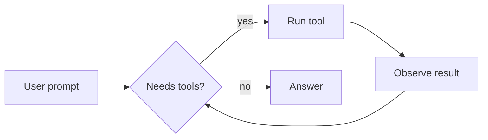
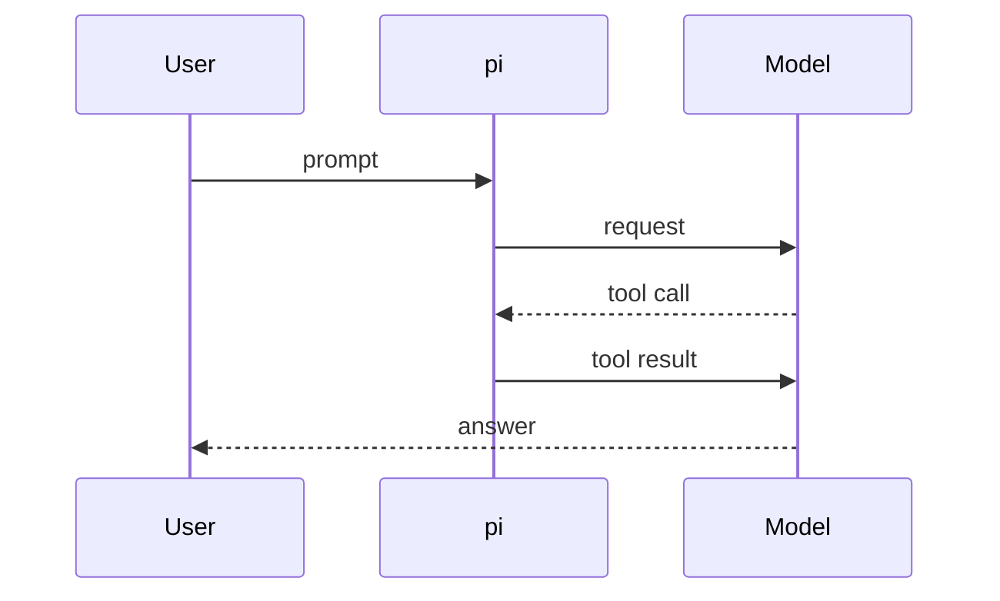

# Rich Markdown preview

This is a sample answer rendered by **pi-rich-markdown**. It mixes the things agents write all the time: prose with *emphasis*, `inline code`, [links](https://github.com/goulinkh/pi-rich-markdown) and ~~mistakes~~, then tables, code, callouts, diagrams and math. Nothing here was sent to the model.

## Why the terminal deserves better

Terminal Markdown usually shows its source: `##` before headings, triple backticks around code, and boxes drawn with `┌─┬─┐` around every table. That is fine for a quick reply but tiring for long answers. Modern terminals draw true colour, half-blocks and inline images, so the renderer can show *structure* instead of *syntax*.

> [!NOTE]
> Everything falls back to pi's own rendering when a block can't be drawn: narrow terminals, terminals without Kitty graphics, or a diagram that fails to parse.

### A comparison table

| Renderer | Tables | Code blocks | Diagrams | Math |
|---|---|---|---|---|
| pi default | Boxed | Fenced | Unicode art | Unicode |
| pi-codex-style-table | Borderless | Fenced | Unicode art | Unicode |
| **pi-rich-markdown** | Borderless, wrapping | Tinted panel | Images | Typeset images |

### Numbers line up on the right

| Image | Before (MiB) | After (MiB) | Saved |
|---|---:|---:|---:|
| Sequence diagram | 4.5 | 1.2 | 73% |
| Screenshot | 5.5 | 2.3 | 58% |
| 19 images in one session | 79.0 | 24.0 | 70% |

### Long cells wrap inside their column

| Setting | What it does | Default |
|---|---|---|
| `PI_RICH_MARKDOWN_IMAGE_BUDGET_MB` | Total decoded image memory shared by pi's images and this extension's diagrams. Older images are deleted first when a new one would go over. | 24 |
| `PI_RICH_MARKDOWN_IMAGE_MAX_MB` | Largest single image. Bigger images are drawn at a lower resolution instead. | 6 |
| `markdown.mermaid` | pi's own Unicode diagrams. Set it to `off` so Mermaid blocks reach this extension and render as images. | streaming |

## Code

A TypeScript example with syntax highlighting:

```typescript
import type { ExtensionAPI } from "@earendil-works/pi-coding-agent";

export default function hello(pi: ExtensionAPI) {
  pi.registerCommand("hello", {
    description: "Say hello",
    handler: async (_args, ctx) => ctx.ui.notify("Hello from an extension!", "info"),
  });
}
```

Long lines wrap with a continuation mark instead of breaking the panel:

```bash
rex split -s "$REX_SESSION" -b "$REX_BLOCK" --split=right --ratio 50 --focus=false --keep-open --label image-demo --json -- node /tmp/kitty-demo.mjs
```

```
A block without a language has no label.
```

## Callouts

> [!TIP]
> Run `/md-preview` after changing your theme to see how every element looks with the new colours.

> [!IMPORTANT]
> Restart pi or run `/reload` after updating the extension.

> [!WARNING]
> Kitty graphics share the terminal's image memory. Keep the budget well under your terminal's limit.

> [!CAUTION]
> Images deleted to stay under the budget turn blank in the scrollback.

> A plain quote keeps pi's style with a lighter bar.
> It can span several lines.

## Lists

- Borderless tables with a bold header
- Code panels without fences
  - Syntax highlighting from pi's theme
  - Continuation marks on wrapped lines
- Callouts for `NOTE`, `TIP`, `IMPORTANT`, `WARNING` and `CAUTION`

1. Install the package
2. Set `markdown.mermaid` to `off`
3. Run `/md-preview`

- [x] Tables
- [x] Code panels
- [ ] Inline images from Markdown ``

## Diagrams





## Math

The Gaussian integral and the Basel problem:

$$
\int_0^\infty e^{-x^2}\,dx = \frac{\sqrt{\pi}}{2}, \qquad \sum_{n=1}^{\infty} \frac{1}{n^2} = \frac{\pi^2}{6}
$$

Inline math such as $E = mc^2$ stays in the text.

---

#### Smaller headings

Level four and below are bold text without a colour, for notes inside a section.
